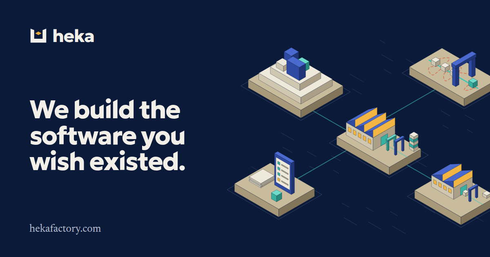

heka is a small group of senior software engineers who build software with coding agents, inside a software factory we built and run ourselves. We build the software people wish existed, for anyone from one person to a Fortune 500, and we teach larger organizations to run a factory of their own.

Agents made writing code cheap. They did not make knowing it is right cheap. The gap between a demo and software you can run a business on (the edge cases, the load, the permissions, the compliance review, the person using it on a phone in a truck) is most of the job, and most of it is verification. The factory is how we close that gap: written requirements go in, many agents build, checks run on every change, a gate decides what goes through, and every miss becomes a new check.

## What's here

These are the tools our factory runs on, in public.

| Repository | What it is | Status |
|---|---|---|
| [vault](https://github.com/heka-vault/vault) | **Heka Vault.** The self-hosted secrets vault our agents and pipelines use. Each gets a key scoped to one project, so credentials stay out of every context window | In daily use |
| [ghost](https://github.com/heka-vault/ghost) | **Ghost.** GitHub issue triage by voice. Say "hey Ghost", ask what needs your sign-off, and approve or request changes without opening the tracker. Runs on your own Linux machine | Early |
| [skills](https://github.com/heka-vault/skills) | Agent skills we use in the factory, for Claude Code, Cursor and Codex | Public |
| [heka-news](https://github.com/heka-vault/heka-news) | The last open-source release of [heka news](https://news.hekafactory.com), which now runs as a closed product | Archived |

## Work with us

- **[Design partners](https://hekafactory.com/design-partners).** Bring a real problem. We write the requirements together and build it to your specification. We take at most two new partners a month.
- **[Build](https://hekafactory.com/build).** Paid work for anyone with a problem software can fix, from one person to an enterprise.
- **[Teach](https://hekafactory.com/teach).** Workshops, audits and factory builds for engineering teams that want to deliver this way themselves.

See [how the factory works](https://hekafactory.com/the-factory) and [what it has made](https://hekafactory.com/work), read [notes from the factory](https://hekafactory.com/blog), or [email us](mailto:eric@polerecky.com?subject=heka%3A%20software%20factory).
